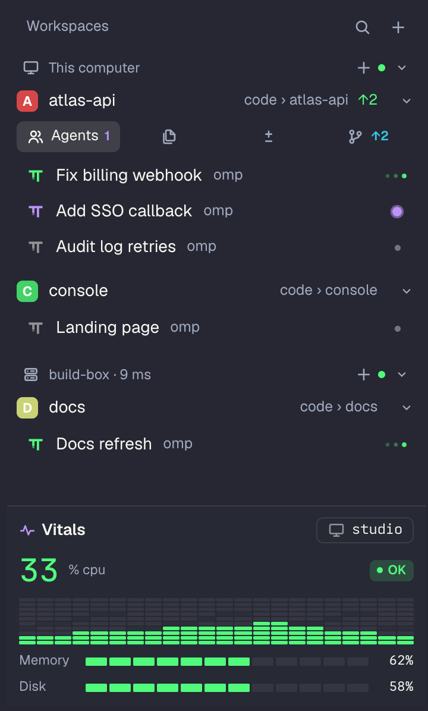
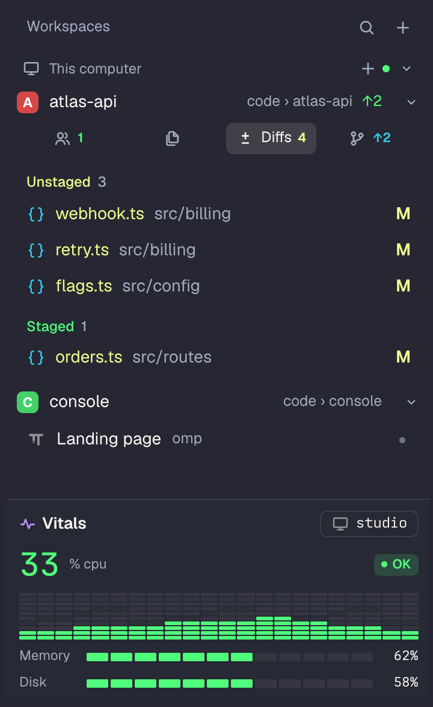

# Kai

A workspaces sidebar for [Tern](https://stencil.so/tern). Every Tern session is a workspace card. Under each card you switch between its agents (tabs and panes), its files, its git changes and its branches. Agent state is live, anything that finished while you were away is marked, and everything can be reordered.



## Install

```sh
tern plugin install github.com/Yupmoh/tern-plugins/kai
```

Update later with the same command plus `--force`. Press `⌘\` to show or hide the sidebar.

The installed version shows at the bottom of the sidebar and in `tern plugin list`. Releases are tagged `kai-vX.Y.Z`.

Optional: PR badges need the [GitHub CLI](https://cli.github.com) (`gh`) signed in. Linear ticket badges ask once for your workspace slug.

## What you see



- **Workspace card:** one line: a colored tile (the initial, or an icon you pick) and the name, with the folder dim at the right and how far the branch is from its upstream (`↑2`). The folder follows the pane you are in. Linear ticket and PR badges sit after it. Under the card you are in, a row of pills switches between its Agents, Files, Diffs and Refs: icons with their counts, the open one named. A folded card shows a one-line summary (`3 tabs · 1 working · main`). Cards only fold when you fold them.
- **Agents:** one row per pane. A single-pane tab is one row; a split tab is a foldable group. A spinner while an agent works, a pulsing dot while it waits for you, ✓ when it finished while you were elsewhere, ✗ when a command failed. The agent's last reply shows as a second line, and the model is in the tooltip.
- **Files:** the workspace folder as a tree, folders first and `.git` hidden, each file with an icon and color for its type. Changed files show their git letter and color, and folders holding changes are tinted. Click a folder to expand it, or a file to open it in Tern.
- **Changes:** conflicts (red), unstaged (amber) and staged (green) sections. Each file is colored by its status: U untracked and A added in green, M modified in amber, D deleted in red, R renamed in blue. Right-click for Stage, Unstage, Open and Copy Path.
- **Refs:** local branches (✓ current, ↑↓ against upstream) and remotes. Right-click a branch to check it out.
- **Vitals:** pinned to the bottom, the machine the shown session runs on: its name, the CPU figure with a level chip that says what tipped it (`WARN swap 91%`), CPU as an equalizer, and memory and disk meters. It follows the current host, including remote hosts over the ssh access Tern already has.

## Using it

| Do | How |
| --- | --- |
| Show or hide the sidebar | `⌘\`, or click the workspace name in the status bar |
| Switch workspace | Click its card, or `⌘⌃1` to `⌘⌃9` by position |
| Jump to what needs you | `⌘⌃0`: a waiting agent first, then a failed command, then a finished agent. The status bar shows "N waiting" while agents wait |
| Focus a pane | Click its row |
| Filter | The search icon in the header, or `⌘⌃F`. Matches workspace, tab and pane names |
| Reorder | Hover a row, click its grip (or right-click → Move…), then click a "Move here" slot. Workspace order is kept; tabs and panes move in Tern itself |
| New tab or close | Hover a row: `+` on a workspace, `✕` on tabs and panes |
| Park a workspace | Right-click → Move to Ice Box. The box icon in the header shows or hides parked ones |
| Icon and color | Right-click a workspace → Set Icon…, Set Color… |
| Sounds | Right-click the Workspaces header → Turn Sounds On. Off by default; toasts always show |
| Size | Right-click the Workspaces header → Compact, Standard (default) or Spacious. Text stays at Tern's UI size; row heights and gaps change |
| Ask Carly | "Open my atlas-api workspace", or give a folder path to create one |

Right-click menus also cover rename, lock, tab colors, splits, moving panes to other tabs or workspaces, interrupting or stopping agents, Copy Path and Reveal in Finder.

### Monorepos and submodules

Open a workspace at the root of a monorepo and Kai also finds the git repos inside it (up to 4 folders deep, skipping `node_modules`, `build` and the like), whether they are independent clones or submodules.

- The card's counts add up every repo.
- **Changes** shows one group per repo with changes, then one line naming the clean ones. Nested repo folders no longer appear as untracked files in the root.
- **Refs** shows one group per repo, the root open and the rest folded. Checkout runs in the repo the branch belongs to.
- Submodules are tagged `submodule`. In the parent, a submodule whose checked-out commit moved shows as one row marked "submodule".

### Several hosts

Workspaces sit under one foldable header per machine (this computer first, then each remote by its host name): its icon, the name, link state or latency, a `+` that starts a new workspace on that machine, a status dot and a chevron to fold. Click a host's name to switch to it; right-click offers Switch, New Session on Host, Add and Disconnect. The sidebar works in remote tabs too. A remote workspace's Files, Changes and Refs buttons open Tern's own panels on that machine, since its folders aren't on this disk.

## How it works

- `window.luau` holds the model (sessions, tabs, panes, agent state, git, files), the per-tab panel, clicks, menus and commands. `view.luau` turns the model into Tern-native nodes. `styles.css` sets Tern's sans face, spacing and shading, scoped to `kai.*` roles. `vitals.luau` samples the current host (local or over ssh) every two seconds with `probe.sh`; its reading is part of the same model and is drawn in the canvas dock, so it stays pinned while the workspaces scroll.
- Tern has no window-level sidebar API, so each tab gets its own canvas pane as a full-height left column. A tab that is already split is rebuilt around it, keeping its shape and ratios. Only the visible tab's panel redraws; the others catch up when shown.
- Tern gives each callback a 50 ms budget. Drawing runs in its own timer callback, git reads are asynchronous, and folder listings run in the background with a 10 s cache. If a stall (sleep, heavy load) makes Tern disable the plugin's timers, Kai notices and keeps working through process callbacks until the next reload. A gap of a minute or more counts as the system having paused the app, not an overrun, so that recovery is logged quietly.
- Fold state, views, workspace order, icons, colors, the Ice Box, unseen marks and settings live in Tern's plugin storage.

**Limits:** Tern canvases only receive clicks, so reordering is pick-then-place rather than drag. The thin scrollbar style applies to all canvases, so other plugins' canvases get it too. Remote workspaces show agent state but no change counts, PR or ticket badges on the card. On macOS Vitals shows a short history of the whole CPU as its bands, because per-core shares need root; Windows is not read.

## Developing

```sh
git clone https://github.com/Yupmoh/tern-plugins
tern plugin link tern-plugins/kai
```

A linked plugin runs from your clone, so edits go live with `tern plugin reload`. `tern plugin types kai` writes `tern.d.luau` for luau-lsp.

## License

[MIT](../LICENSE)
